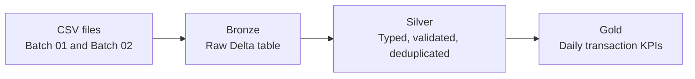

# Fintech Transaction Analytics — Databricks Medallion Architecture

A Data Engineering portfolio project that processes **fictional fintech transactions** using **Databricks, PySpark, Delta Lake, and Unity Catalog**. It demonstrates initial batch ingestion and an incremental update across the Bronze, Silver, and Gold layers.

**Scope:** Six notebooks covering the initial Batch 01 pipeline and incremental Batch 02 processing. This repository documents completed notebook-based processing; it does not represent an automated or production-deployed pipeline.

## Architecture

| Layer | Processing responsibility | Persisted table |
| --- | --- | --- |
| **Bronze** | Load raw CSV records as strings, including invalid values and duplicates. Append Batch 02 to the existing Delta table. | `workspace.default.fintech_transactions_bronze` |
| **Silver** | Convert data types, apply validation rules, remove initial exact duplicates, and use an insert-only Delta `MERGE` for new transaction IDs. | `workspace.default.fintech_transactions_silver` |
| **Gold** | Aggregate by transaction date and type; calculate transaction counts by status and completed amounts. Incrementally recalculate affected groups and apply Delta `MERGE`. | `workspace.default.fintech_transactions_daily_gold` |

## Repository guide

Read the notebooks in the following order:

| Order | Notebook | Purpose |
| --- | --- | --- |
| 01 | [`01_bronze_ingestion.ipynb`](notebooks/01_bronze_ingestion.ipynb) | Ingest Batch 01 and create the initial Bronze Delta table. |
| 02 | [`02_silver_transformation.ipynb`](notebooks/02_silver_transformation.ipynb) | Apply data quality checks, type conversions, and deduplication. |
| 03 | [`03_gold_aggregation.ipynb`](notebooks/03_gold_aggregation.ipynb) | Calculate and persist initial daily transaction KPIs. |
| 04 | [`04_incremental_ingestion.ipynb`](notebooks/04_incremental_ingestion.ipynb) | Append Batch 02 to Bronze and verify the ingestion history. |
| 05 | [`05_incremental_silver.ipynb`](notebooks/05_incremental_silver.ipynb) | Detect incremental Bronze records; validate, compare, and insert new Silver transactions using Delta `MERGE`. |
| 06 | [`06_incremental_gold.ipynb`](notebooks/06_incremental_gold.ipynb) | Identify affected Gold groups; recalculate, merge, reconcile, and test logical idempotency. |

The fictional source files are available in [`data/`](data/): `transactions_batch_01.csv` and `transactions_batch_02.csv`.

## Source data and quality rules

Each source CSV contains six fields: `transaction_id`, `customer_id`, `transaction_ts`, `transaction_type`, `amount`, and `status`.

Bronze preserves the incoming fields as strings. Silver converts `amount` to `DECIMAL(12,2)` and `transaction_ts` to `TIMESTAMP`, then checks:

1. `transaction_id` is not null.
2. `customer_id` is not null.
3. `amount` is not null and greater than zero.
4. `transaction_ts` can be parsed as a timestamp.
5. `transaction_type` belongs to `PIX_IN`, `PIX_OUT`, `CARD_PURCHASE`, or `BILL_PAYMENT`.
6. `status` belongs to `COMPLETED`, `PENDING`, or `FAILED`.

The notebooks separate valid and invalid records for inspection. The initial Silver notebook removes exact duplicate rows; incremental Silver uses `transaction_id` as the matching key for insert-only `MERGE`.

## Verified results — Batch 01 and Batch 02

These values describe the **historical checkpoint documented by the six notebooks**, not necessarily the current state of a Databricks workspace.

| Checkpoint | Result |
| --- | ---: |
| Batch 01 raw Bronze records | 12 |
| Batch 01 valid records before deduplication | 9 |
| Batch 01 invalid records | 3 |
| Initial Silver records after deduplication | 8 |
| Batch 02 incoming Bronze records | 8 |
| Bronze records after Batch 02 | 20 |
| Batch 02 valid / invalid records | 7 / 1 |
| New Silver transactions inserted by the first incremental `MERGE` | 6 |
| Silver records after Batch 02 | 14 |
| Gold date/type groups after Batch 02 | 8 |

**Final Gold reconciliation for this checkpoint:** 14 transactions = 10 `COMPLETED` + 2 `PENDING` + 2 `FAILED`; total `completed_amount` = **1,210.75**. Pending and failed amounts are excluded from the completed amount KPI.

## Incremental processing and idempotency

- **Bronze:** Batch 02 is appended with Delta Lake `append` mode. Reprocessing that write can append the same records again; this notebook does **not** provide idempotent file ingestion.
- **Silver:** Delta Time Travel and `exceptAll()` identify the Bronze increment. Validation excludes an invalid transaction type; a `left_anti` join identifies new IDs, and an insert-only Delta `MERGE` matches on `transaction_id`. Its recorded first execution inserted six transactions; a repeated `MERGE` inserted zero.
- **Gold:** New Silver records determine the affected `(transaction_date, transaction_type)` groups. The notebook recalculates KPIs from Silver for those groups and uses Delta `MERGE` to update matched groups or insert new ones. A repeated `MERGE` preserved the Gold values, although matched rows were updated and a new Delta version was created.

## Technology stack

- Databricks notebooks and Unity Catalog managed tables / volumes
- Apache Spark with PySpark DataFrame transformations
- Delta Lake: managed tables, `MERGE`, transaction history, and Time Travel
- Databricks SQL for Delta transaction history inspection

## Environment and execution considerations

The notebooks use the catalog/schema `workspace.default`, the Unity Catalog volume path `/Volumes/workspace/default/fintech_landing/`, and the fully qualified table names above. The source CSVs must be placed in that volume to match the notebook paths.

**Do not run every cell against an existing populated workspace.** The initial table-creation cells use `mode("error")`, Batch 02 Bronze uses non-idempotent `append`, several assertions reflect historical record counts, and incremental notebooks refer to specific Delta versions. The repository is a record of executed project stages, not a one-command deployment or a generic restart procedure.

## Scope and limitations

This project demonstrates notebook-based processing and validation. It does **not** claim completed job orchestration, scheduling, operational monitoring, or production deployment. Invalid records are inspected in DataFrames rather than persisted to a dedicated quarantine table. The Silver `MERGE` is insert-only and does not implement updates to previously processed transaction IDs.

The examples use synthetic transactions and intentionally small datasets to make the transformations, tests, and Delta operations easy to inspect.
